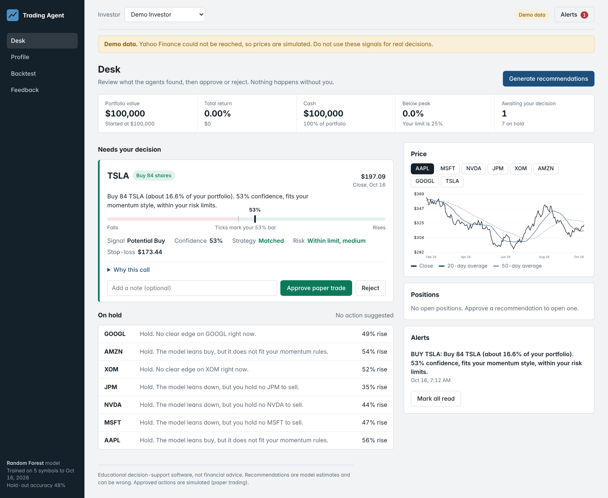

# Personalized AI Trading & Investment Agent

An AI decision-support system for traders and investors. It combines a machine-learning market
signal with the user's own risk level, trading style and goals, and turns the result into a
**Buy / Sell / Hold** recommendation with a plain-language explanation.

The user stays the final decision-maker: every recommendation must be approved or rejected, and
approved actions are executed as **paper trades** (simulated, no real money).

> Educational decision-support software, not financial advice. Model estimates can be wrong.

## Screenshot



*The Desk: portfolio figures, a recommendation waiting for approval (with confidence, strategy
fit, risk check and stop-loss), held symbols, a price chart, open positions and alerts. The
screenshot uses simulated demo prices.*

## How it works

```
User profile ─┐
              ├─> Personal Agent ─> Strategy Agent ─> Risk Agent ─> Decision Engine ─> Recommendation
Market data ─> ML model (probability of a rise) ─┘                                          │
                                                                          Human approval ◄──┘
                                                                                │
                                                       Paper trading ─> Feedback & evaluation
```

| Component | What it does |
|-----------|--------------|
| **Personal Agent** | Holds the user's risk level, trading style, goals, preferred assets and limits. |
| **ML prediction** | Random Forest (or XGBoost) trained on price, volume, trend, volatility and technical indicators. Outputs a probability, never a certainty. |
| **Strategy Agent** | Checks the signal against the user's style: momentum, swing, mean reversion or long-term. |
| **Risk Agent** | Enforces position size, stop-loss, risk per trade, volatility and drawdown limits. Can reject a trade. |
| **Decision Engine** | Produces BUY / SELL / HOLD, position size, stop-loss price and the reasons. |
| **Notification Agent** | Raises an alert when a recommendation matches the user's preferences. |
| **Human approval** | Approve or reject each recommendation, optionally with a note. |
| **Paper trading** | Approved trades are simulated with commission and slippage. |
| **Backtest** | Walk-forward replay of the same pipeline over historical data. |
| **Feedback loop** | Compares past recommendations and user decisions with what the market did. |

## UI sections

- **Desk**: recommendations awaiting a decision, holds, portfolio figures, price chart, alerts.
- **Profile**: risk level, trading style, goals, preferred assets and risk limits.
- **Backtest**: replay the strategy and risk rules on history.
- **Feedback**: how past recommendations and decisions turned out.

## Getting started

Requires Python 3.10 or newer.

```bash
python -m venv .venv
source .venv/bin/activate          # Windows: .venv\Scripts\activate
pip install -e ".[dev]"
cp .env.example .env               # optional, see Configuration

trading-agent --reload
```

Open <http://127.0.0.1:8000>. Create an investor profile, click **Generate recommendations**,
then approve or reject what appears. Interactive API docs are at <http://127.0.0.1:8000/docs>.

Equivalent without the console script:

```bash
uvicorn trading_agent.api.main:create_app --factory --reload
```

### Data source

By default (`TA_DATA_SOURCE=auto`) the app uses Yahoo Finance via `yfinance`. If it cannot be
reached, it falls back to deterministic **synthetic demo data** and shows a "Demo data" banner in
the UI. Do not use demo-data signals for real decisions.

## Configuration

All settings are environment variables with the `TA_` prefix (see `.env.example`).

| Variable | Default | Meaning |
|----------|---------|---------|
| `TA_DATA_SOURCE` | `auto` | `auto`, `yfinance` (live only) or `synthetic` |
| `TA_ML_ALGORITHM` | `random_forest` | `random_forest` or `xgboost` |
| `TA_DEFAULT_SYMBOLS` | `["AAPL","MSFT","NVDA","JPM","XOM"]` | Watchlist when a profile has no preferred assets |
| `TA_HISTORY_YEARS` | `5` | Years of history used for training |
| `TA_HORIZON_DAYS` | `5` | Prediction horizon in trading days |
| `TA_STARTING_CASH` | `100000` | Paper-trading starting balance |
| `TA_COMMISSION_BPS` / `TA_SLIPPAGE_BPS` | `5` / `5` | Simulated trading costs |
| `TA_DATA_DIR` | `./data` | SQLite database, price cache and trained models |

## API overview

| Method | Path | Purpose |
|--------|------|---------|
| GET | `/api/health`, `/api/meta` | Status, model info and defaults |
| POST/GET/PUT | `/api/profiles` | Create, list, update investor profiles |
| GET | `/api/market/{symbol}` | Price history with indicators |
| GET | `/api/market/{symbol}/signal` | ML signal for one symbol |
| POST | `/api/recommendations/generate` | Run the agent pipeline for a profile |
| POST | `/api/recommendations/{id}/approve` or `/reject` | Human decision |
| GET | `/api/portfolio/{profile_id}`, `/api/orders` | Paper portfolio and orders |
| POST | `/api/backtest` | Walk-forward backtest |
| GET/POST | `/api/feedback/{profile_id}` | Outcome evaluation |
| GET/POST | `/api/model`, `/api/model/train` | Model info and retraining |

## Project structure

```
src/trading_agent/
├── agents/      Personal, Strategy, Risk, Notification agents and the Decision Engine
├── api/         FastAPI app and routes
├── data/        Market-data providers (Yahoo Finance, synthetic fallback, caching)
├── ml/          Feature engineering and model training
├── services/    Recommendations, paper trading, backtest, feedback
├── web/static/  Front-end (HTML, CSS, JavaScript)
├── config.py    Settings
├── db.py        SQLite storage
├── schemas.py   Pydantic models
└── cli.py       `trading-agent` command
docs/images/     README screenshots
```

## Roadmap

1. User profile and preferences
2. Market data connection and preparation
3. ML prediction model
4. AI agents (Personal, Strategy, Risk, Notification)
5. Recommendation and human approval workflow
6. Paper trading and feedback loop

## Disclaimer

This project is for education and research. It does not provide financial advice, and
recommendations are model estimates that can be wrong. Approved actions are simulated; the
system never places real orders.
